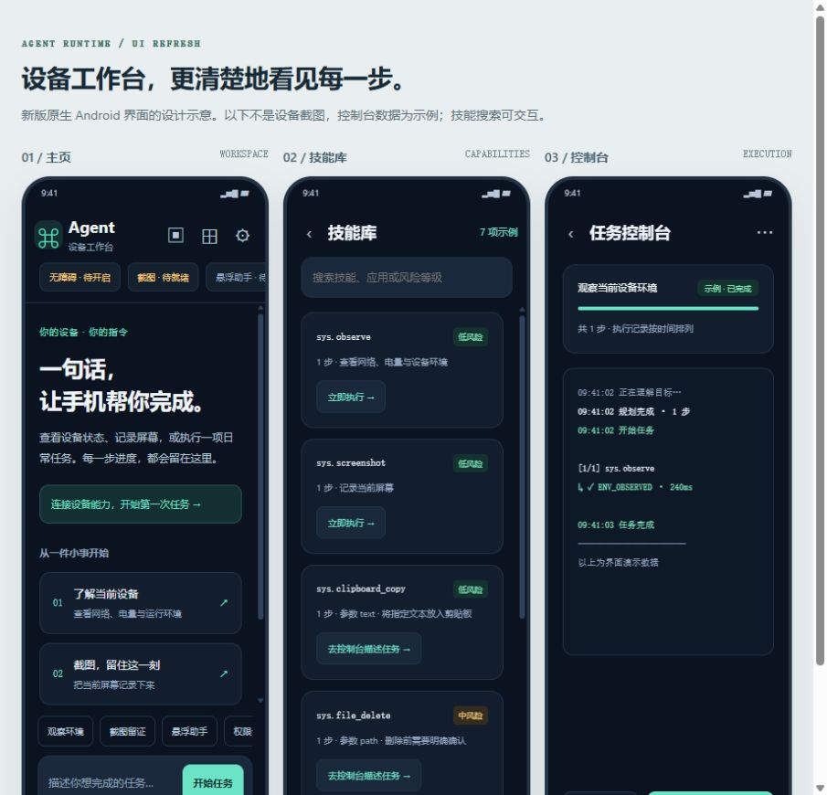

# Agent Runtime V1.9.1 接手报告

日期：2026-10-30（北京时间）

仓库：`xianshengl487-star/agentruntime`

审查基线：`676e8a2cde5c2662ceb5d6c7515c64a5b60db989`

改动分支：`codex/runtime-safety-ui-20261030`

本轮已完成代码审查、安全与功能修复、原生 Android 界面改版和构建验证。版本更新为 **1.9.1 / versionCode 8**。改动通过草稿 PR 交付，主分支由维护者审阅后合并。

## 已修复的问题

| 优先级 | 原问题与影响 | 本轮处理 |
|---|---|---|
| P1 | 控制台执行目标或技能时固定开启自动确认，高风险操作可能跳过用户同意 | 默认关闭；Release 忽略测试自动确认；加入 Debug/Release 双变体测试 |
| P1 | Debug 的外部任务入口可被普通应用显式调用，并可传入任务或模型配置 | 入口要求调用者拥有系统 `DUMP` 权限；Release 仍不对外导出 |
| P1 | 不同界面、悬浮窗等入口可以同时开始任务，互相影响风险开关和取消状态 | 规划到执行统一占用；拒绝第二个入口；运行时另有并发保护；退出时清理测试授权 |
| P1 | 等待确认期间收到取消或超过期限后，仍可能执行一次操作 | 确认返回后再次检查取消和期限；测试证明停止后文件不会被删除 |
| P1 | 调试日志包含完整规划参数、查找文字、屏幕节点文字和弹窗内容 | 保留错误码、数量与命中状态；去掉这些敏感内容 |
| P2 | 同一应用内连续两个点击步骤被误当成重复启动，前一步被删除 | 保留完整步骤与顺序，覆盖“新建 → 保存”回归用例 |
| P2 | 云响应逐字节块独立解码，可能破坏跨块中文或表情；响应没有统一大小上限 | 本地和云端统一完整 UTF-8 解码，最多 2 MiB；云端请求与自检均禁止自动重定向 |
| P2 | 九个以上规划步骤可能让动作预算超过解析层声明的 64 上限 | 将自动调整后的预算夹紧到 64 |
| P2 | 文件路径校验在部分宿主文件系统上不能解析符号链接 | 跟随真实已有父目录解析；覆盖文件链接、目录链接及尚不存在的输出文件 |
| P2 | 协议名称和风险等级的大小写转换受设备语言影响 | 使用固定语言规则；土耳其语环境下 `high` 仍解析为 HIGH |
| P2 | Android 8/9 磁贴使用了 Android 10 才有的副标题接口；Android 12+ 关闭系统面板依赖受保护广播 | 增加版本保护；新系统通过已授权无障碍能力收起通知栏，缺少服务时明确拒绝 |
| P2 | 控制台日志无限增长、阅读历史时被强制滚动、返回界面后日志不完整 | 限制显示缓冲区；尊重用户滚动位置；重新进入时补齐最近记录 |

高风险确认会展示**完整参数和本次解析后的动作清单**，包括长文本尾部；控制字符作可见转义。一次同意仅覆盖本次固定技能步骤，下一步或重试需要重新确认。确认可以显示在本应用前台，或使用用户已授予的悬浮窗权限；没有可用确认界面、用户取消、界面离开或等待超时都按拒绝处理。

## 界面改进

- 统一深色青绿色配色、卡片、输入框与文字层级，提高正文和次要文字对比度。
- 主页改为设备工作台，提供清晰欢迎页、中文能力状态、任务输入和快捷入口。
- 规划过程可见；主页执行按钮可直接停止任务；Release 隐藏测试自动确认选项。
- 工具调用继续保留等宽字体，说明与用户内容使用常规字体。
- 技能库支持按技能、应用和中文风险等级搜索，并有无结果提示。
- 需要参数的技能入口实际打开控制台。
- 复用主页顶栏与输入区布局，保留横屏双栏；去除重复预留的状态栏空白。
- 布局测试的导出结果改到构建目录，避免每次测试覆盖历史版本文档。



[交互设计预览](shots/v191/ui-preview.html) 是按本轮配色和布局制作的 HTML 示意，控制台内容为演示数据。应用本体仍是原生 Android。

## 验证结果

| 检查 | 结果 |
|---|---|
| Debug 单元与布局测试 | **343 项，342 通过，0 失败，1 跳过** |
| Release 单元与布局测试 | **227 项全部通过，0 失败、0 跳过** |
| 新增回归用例 | 22 项，覆盖确认、并发、取消、步骤顺序、长文本、UTF-8、文件链接、语言及界面搜索等 |
| Android Lint | **0 Error / Fatal，216 Warning** |
| 构建 | 主应用 Debug、Release 与测试替身应用 Debug 均成功 |
| APK 资源和能力核验 | 通过：关键类、动作、技能、模型资产、Manifest、双 ABI |
| Debug / Release 产物边界 | 通过：Release 不包含调试 fixture 组件或类；外部任务入口不导出 |
| 预览包签名 | APK v2 / v3 签名验证通过 |
| 布局结构 | 320dp 小屏、411dp 竖屏、891dp 横屏与 800dp 平板通过 |

跳过项是 POSIX 文件权限位测试，Windows 文件系统不支持对应权限模型。其他路径和符号链接测试已实际执行。

Lint 的 Warning 主要涉及硬编码中文文案、未使用资源和国际化等。权限用途与已受版本保护的 API 误报采用了带说明的局部标记；现在 Lint 错误会阻止构建，Release 检查也已开启。

本轮对生产依赖 `com.microsoft.onnxruntime:onnxruntime-android:1.18.0` 的 OSV 查询返回 0 条匹配。这只代表该数据库中此 Maven 坐标的查询结果，未对模型权重做实际推理验证。ONNX Runtime 对模型来源和资源消耗的说明见[官方模型验证文档](https://onnxruntime.ai/docs/)。

## 交付与运行条件

可安装预览包使用 **Release 逻辑、标准测试证书签名**，用于本次体验与验收；生产分发应使用维护者自己的发布证书。另保留未签名 Release 包，便于正式签名。预览包没有测试自动确认入口，调试 fixture 也不会打入其中。

构建环境：Windows、JDK 21、Gradle 8.8、Android SDK 34。完整测试与构建任务为：

```text
:agent:testDebugUnitTest :agent:testReleaseUnitTest
:agent:assembleDebug :agent:assembleRelease :agenttestapp:assembleDebug :agent:lintDebug
```

本机为构建进程配置了临时 JDK 本地通信兼容参数，并使用缓存的 Robolectric Android 运行时及仓库中已有的 Maven 镜像。没有更改系统级环境设置。

本轮没有连接真机，现有模拟器因固件虚拟化未开启而无法完成设备验收。因此字体像素效果、系统键盘遮挡、真实悬浮确认、厂商 ROM 权限跳转与实际第三方应用操作仍需设备验证。历史设备记录保留，其结论对应各自历史 APK。

后续需重点验证的代码范围包括网页读取与当前浏览器窗口的绑定，以及真实外发前的会话接收人核对。端侧 VLM 的生成链路仍为项目既有的未完成能力，本轮未将其标为可用。
